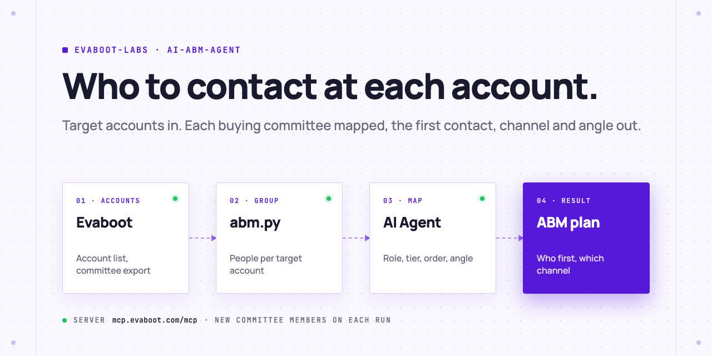
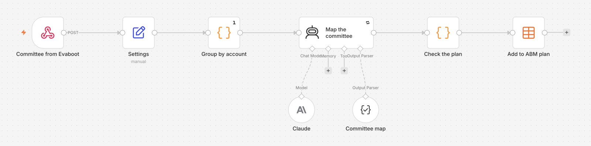

<picture>
  <source media="(prefers-color-scheme: dark)" srcset=".github/assets/banner-dark.png">
  
</picture>

# AI ABM agent

Give your AI Agent a list of target accounts. It exports each account's buying committee from LinkedIn Sales Navigator with Evaboot, maps every person to a role, tiers the accounts, and writes who to contact first, on which channel and with which angle. You do the outreach.

[](AGENTS.md)
[](https://evaboot.com/mcp)
[](LICENSE)

## Set it up in one prompt

Paste this into Claude Code, Codex or Cursor:

```text
Clone https://github.com/evaboot-labs/ai-abm-agent, read AGENTS.md and follow the skill. Map the buying committee of my target accounts.
```

<details>
<summary>Or install the skill</summary>

Claude Code:

```text
/plugin marketplace add evaboot-labs/ai-abm-agent
/plugin install ai-abm-agent@evaboot-labs-ai-abm-agent
```

Codex, Cursor and other agents:

```bash
npx skills add evaboot-labs/ai-abm-agent
```

</details>

## How it works

**1. Your target accounts become a Sales Navigator list.** Your agent asks what you sell and who buys it, writes it into [`BUYERS.md`](BUYERS.md), and saves your accounts as a Sales Navigator account list with Evaboot: from company names, an account search, or a list you already have.

**2. One export finds every buying committee.** A people search filtered on that list, with the functions and seniority of your buyers, is exported with verified emails. `abm.py` groups the people by account and drops the ones whose main job is at another company.

```text
$ python3 abm.py facts data/committee.json data/accounts.json > queue/accounts.json
dropped 24 people whose current company is not a target account
```

**3. Your agent maps each committee and writes the plan.** A tier for each account, a role for each person (decision maker, champion, influencer, user or skip), then who to contact first, on which channel, with one angle each. `abm.py check` rejects a person with no role, an email to an unverified address, a broken contact order, an angle over 30 words, or a guess at someone's gender.

One account of a real plan, with the people left out:

| # | Role | Title | Channel | Angle |
|---|---|---|---|---|
| 1 | Champion | Directeur commercial | email | Runs sales day to day: show how 43 sellers stop copying Sales Navigator leads by hand. |
| 2 | Decision maker | Chief Commercial Officer | email | One month in as CCO: a pipeline plan for the first quarter starts with clean, verified lead lists. |
| 3 | User | Strategic Account Director | email | Strategic accounts need every stakeholder mapped: export a whole account's buying committee in one click. |

**4. The committee stays current.** A recurring export repeats the search and returns only the people who are new to it, such as a VP Sales who joined last month.

**5. Or run it in n8n.** Evaboot sends the committee to a webhook, Claude maps each account, and the plan lands in an n8n Data table.



## What you need

- An [Evaboot account](https://dash.evaboot.com/accounts/signup/?last_click_origin=ai-abm-agent-repo) and a Sales Navigator seat.
- An AI Agent that can use an MCP server: Claude Code, Codex, Cursor, or the n8n version.
- Python 3.9+, with no packages to install.
- Cost: 1 Evaboot credit per exported account and per exported person. Our test (10 accounts searched, 5 kept, 59 people exported) cost 69 credits.

## Go further

| Page | For |
|---|---|
| [docs/connect-your-agent.md](docs/connect-your-agent.md) | The setup by hand, for each agent |
| [docs/n8n.md](docs/n8n.md) | The same agent in n8n, into a Data table |
| [BUYERS.md](BUYERS.md) | Your offer, the account tiers, the buying committee and the contact rules |

---

Agents: start at [AGENTS.md](AGENTS.md) · Built by [Evaboot](https://evaboot.com) · More workflows at [github.com/evaboot-labs](https://github.com/evaboot-labs) · [MIT license](LICENSE)
